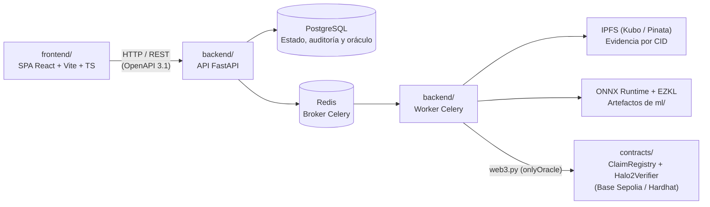

# Veredic — Prototipo de gestión de siniestros con zkML y smart contracts

**Proyecto Final de Ingeniería — Ingeniería en Informática (UADE)**  
**Autores:** Juan Ignacio Alippi y Conrado Bratti

Prototipo para la automatización de siniestros automotores menores combinando clasificación de daños con redes neuronales convolucionales (*off-chain*), verificación criptográfica de inferencia mediante pruebas de conocimiento cero (*zkML* con EZKL, Halo2/KZG sobre BN254), registro inmutable y liquidación condicionada en smart contracts (Base Sepolia / EVM) y almacenamiento de evidencia fotográfica en IPFS, con escalamiento explícito a revisión humana.

## Arquitectura general



El diseño separa la experiencia Web2 del asegurado de la capa criptográfica: solo el servicio backend opera la billetera del oráculo (Modelo A), mientras que las decisiones y las transiciones de estado del reclamo se asientan on-chain mediante una máquina de siete estados (`ClaimRegistry.sol`). Ante una prueba inválida, el contrato no revierte la transacción: asienta `VerificacionFallida` y deriva el caso a revisión humana.

Para la verificación *zkML* se adopta una arquitectura de **características fuera del circuito** (*features-afuera*): un extractor `MobileNetV3-small` (ajustado sobre CarDD y luego congelado) calcula un vector de 576 características fuera del circuito, y el circuito Halo2/KZG (`logrows = 15`) prueba la cabeza lineal `576 → 6` que emite *logits*. La frontera de confianza es escalonada: el tramo `píxel → características` se acredita por replicación externa con el extractor ONNX publicado por CID, y el tramo `características → logits` por prueba criptográfica verificada en `Halo2Verifier.sol`.

## Estructura del repositorio

| Directorio | Tecnología principal | Responsabilidad |
| --- | --- | --- |
| [`backend/`](backend/README.md) | Python 3.12, FastAPI, SQLAlchemy, PostgreSQL, Redis/Celery, ONNX Runtime, EZKL, `web3.py` | API REST de la aseguradora, worker de inferencia y pruebas zkML, publicación en IPFS, coordinación durable del oráculo y contrato OpenAPI (`backend/contract/openapi.yaml`). |
| [`frontend/`](frontend/README.md) | React, TypeScript, Vite, Tailwind CSS, shadcn/ui, TanStack Query, Zod, MSW | Aplicación SPA con las nueve vistas del prototipo (`MK-01` a `MK-09`) y control de vistas por perfil (Asegurado, Operador, Revisor y Auditoría pública). |
| [`contracts/`](contracts/README.md) | Solidity, Hardhat | Contrato `ClaimRegistry.sol` con máquina de siete estados y patrón `onlyOracle`, verificador `Halo2Verifier.sol` generado por EZKL, suite de pruebas y scripts de despliegue local y Base Sepolia. |
| [`ml/`](ml/README.md) | Python 3.12, PyTorch, ONNX, EZKL 23.0.5, Foundry (`anvil`) | Experimentos de viabilidad zkML (`fase0/`), entrenamiento sobre CarDD, barrido de umbrales de confianza, exportación ONNX, generación del verificador Solidity y verificación on-chain (`fase1/`). |

## Resultados técnicos de referencia

- **Modelo y circuito (`ml/`):** 93,2 % de *accuracy* y 0,948 de *macro-F1* sobre CarDD (8.740 parches); `logrows = 15`, 0,79 GB de RAM pico de *proving*, ~4,2 s por prueba, verificador de 13.389 bytes (dentro del límite EIP-170) y 299/300 de fidelidad circuito vs. punto flotante.
- **Umbrales de confianza:** derivación a revisión humana en `0,90` y liquidación automática en `0,95` (medidos sobre 785 muestras de prueba).
- **Verificación on-chain (`contracts/` y `backend/`):** despliegue y ciclo de vida verificados en Base Sepolia (`chainId 84532`) con verificación real de pruebas Halo2/KZG (~1,19 M gas).

## Requisitos generales

- **Python 3.12** y [`uv`](https://docs.astral.sh/uv/) (`backend/` y `ml/`)
- **Node.js** y `npm` (`frontend/` y `contracts/`)
- **PostgreSQL 17/18** y **Redis** (para ejecución real de `backend/`)
- **Kubo (IPFS)** (opcional en desarrollo; puede usarse `PUBLICADOR_EVIDENCIA=local`)
- **Foundry (`anvil`)** (opcional, para verificación on-chain desde `ml/`)

## Inicio rápido (entorno local)

Cada módulo incluye su propio `README.md` con las instrucciones detalladas y variables de entorno (`.env.example`).

### 1. Contratos (`contracts/`)

```shell
cd contracts
npm install
npx hardhat test
```

Para levantar un nodo local y desplegar `Halo2Verifier` + `ClaimRegistry`:

```shell
npx hardhat node
# En otra terminal:
npx hardhat run scripts/deploy-local.js --network localhost
```

### 2. Backend (`backend/`)

```shell
cd backend
uv sync
# Configurar DATABASE_URL hacia una instancia PostgreSQL local
uv run alembic upgrade head
uv run uvicorn app.main:app --reload
```

Sin variables adicionales, el backend utiliza adaptadores simulados para inferencia, pruebas y cadena (y `PUBLICADOR_EVIDENCIA=local` para pruebas sin Kubo). Los adaptadores reales (`onnx`, `ezkl`, `web3`) se activan explícitamente por entorno; consultar [`backend/README.md`](backend/README.md).

### 3. Frontend (`frontend/`)

```shell
cd frontend
npm install
npm run dev
```

Sin `VITE_API_URL`, el entorno de desarrollo intercepta la API con mocks de MSW fieles al contrato OpenAPI. Para conectar con el backend local:

```shell
VITE_API_URL=http://127.0.0.1:8000 npm run dev
```

### 4. Pipeline zkML (`ml/`)

```shell
cd ml
uv sync
```

El flujo completo de entrenamiento, compilación del circuito, generación de pruebas y emisión del verificador Solidity se encuentra documentado en [`ml/README.md`](ml/README.md).

## Licencia

Distribuido bajo licencia MIT. Ver [`LICENSE`](LICENSE).
